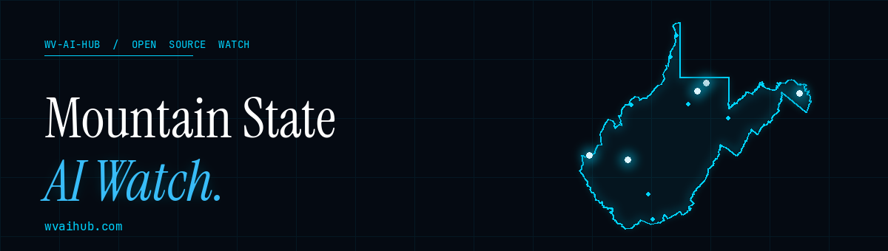

<p align="center">
  
</p>

# WV-AI-HUB

> **West Virginia AI Watch.** Mapping AI across the Mountain State: every data center and AI power project, the PSC filings, DEP permits, lawsuits, hearings, protests, and town halls around them, and the people and companies involved. Plus twelve AI innovation hubs. Open source, fork-friendly, and built to be adapted for any state, county, school, or community.

**🌐 Live: [wvaihub.com](https://wvaihub.com)** &nbsp;·&nbsp; Curated by [MØNTAN1.com](https://montaniai.com).

The site is static: plain HTML, CSS, and JavaScript modules, with all content in readable JSON files under `data/`. No framework, no build step, no backend. Drop the folder on any static host (Netlify, Cloudflare Pages, GitHub Pages, S3) and it works. The map is drawn as SVG from U.S. Census county boundaries. **Design direction: "The Watch Desk"** (see `design/`): a night-shift newsroom that leads with what's happening and when you can show up, makes the scale physical, and puts a receipt on every claim.

---

## What's inside

- **Front page.** Live countdowns to the next times you can show up (computed from your date), the headline numbers, a dated desk log, "this week near you" for the county you pick, where every docket fight stands, and the map.
- **Map with a time slider.** 55 counties, 13 projects colored by status, the MARL and Valley Link corridors, and upcoming-date badges by county. Press play to watch projects appear, get certified, go under construction, and get contested, from HB 2014 (Apr 30, 2025) to the decisions still ahead.
- **Case files.** One page and one shareable link per project (`#/project/monarch`): facts, scale made physical (Monarch's 864 gas engines as 864 dots), a dated timeline with a source on every entry, permits and court cases, people and connections, how to take part, redactions where the law withholds information, and receipts.
- **Docket stage board.** 19 court, PSC, DEP, and legislative matters in five columns, from not yet filed to decided, each with its case number, a rubber stamp, and its next date.
- **Calendar.** About 50 public dates (hearings, comment deadlines, PSC and court dates, legislative meetings, protests, town halls, developer open houses) plus 17 standing county meetings. Agenda and month views, filters, and `.ics` downloads. Subscribe to everything at `/calendar.ics`.
- **People.** A connections web of 49 people, firms, companies, projects, and cases with 54 sourced links (click any name to focus it), plus a 52-entry directory.
- **County sheets.** A printable one-page field sheet for each of 24 counties: projects, standing meetings with times and addresses, upcoming dates, what to watch for, and a QR code back to the site.
- **Hubs.** The other AI story: research, schools, and startups in 12 cities.
- **Receipts.** Every item was checked against its source on Nov 3, 2026 (183 confirmed, 11 from PSC notices, 8 shown as ⚠ Verify, 0 gaps). Turn on **Receipts mode** in the header to see sources inline everywhere. Method and item-by-item results: `research/2026-11-verification-log.md`.
- **Two themes.** Ink (dark) and Newsprint (light), which is also the print style.

---

## Run locally

Any static server works. The simplest:

```bash
python3 -m http.server 8000
# then open http://localhost:8000
```

VS Code users can install the **Live Server** extension and right-click `index.html` → "Open with Live Server."

---

## File structure

```
.
├── index.html            Shell (header, footer, SEO); the views render from assets/js/
├── assets/css/watch.css  All styles (ink + newsprint themes, print)
├── assets/js/            main.js (router), data.js, lib.js, map.js, parts.js, views/*.js
├── data/                 The content: projects, docket, events, standing, people, network, lines, desk, hubs, receipts, meta, geo
├── calendar.ics          Subscribable calendar (built from data/events.json)
├── feed.json             JSON Feed of the desk log
├── tools/
│   ├── check.py          Validate data/ before publishing (references, dates, sources, staleness, optional link check)
│   ├── build_feeds.py    Build calendar.ics, feed.json, county QR codes, and the sitemap
│   ├── build_geo.py      Build data/geo.json from Census county boundaries
│   └── migrate/          One-time migration from the old single-file site
├── docs/update-plan.md   How the site is kept current: sources, cadence, checklists, verification rules
├── DOCS.md               Architecture and data formats
├── research/             Sourced dossier, calendar receipts, PSC watchlist, verification log and scripts
├── design/               Revamp proposal, concept board, screenshots
└── assets/               Icons, social image, sitemap, QR codes, and the image scripts in assets/scripts/
```

To regenerate the visual assets:

```bash
python3 -m pip install Pillow
python3 assets/scripts/generate_og.py
python3 assets/scripts/generate_favicons.py
python3 assets/scripts/generate_readme_assets.py
```

## Update the data

Edit the JSON in `data/`, then check and rebuild:

```bash
python3 -I tools/check.py
python3 -I tools/build_feeds.py
```

The checker prints errors (fix before publishing) and warnings (the to-do list for the next update). `build_feeds.py` needs `pip install segno` for the QR codes. The full routine is in [`docs/update-plan.md`](docs/update-plan.md), and the data formats are in [`DOCS.md`](DOCS.md).

---

## Fork this for your state, county, school, or community

The whole point of releasing the source is so anyone can clone this and stand up an innovation index for their own region. The pattern adapts cleanly to:

- **A state** (e.g. Vermont AI Innovation Index, North Carolina Renewable Energy Map)
- **A county or town** (e.g. Mercer County Tech Index, Charleston Bitcoin Map)
- **A school or university district** (e.g. WVU College of Engineering project tracker)
- **A community organization** (e.g. Tucker United issue tracker, Appalachian Trail volunteer hubs)
- **An industry vertical in a region** (e.g. solar installers in the Southeast, biotech in the Research Triangle)

### Step-by-step

1. **Fork and clone**
   ```bash
   gh repo fork m0ntan1/WV-AI-HUB --clone
   cd WV-AI-HUB
   ```

2. **Replace the map.** Download county boundaries for your state as GeoJSON (the U.S. Census cartographic boundary files, or the Census-derived `geojson-counties-fips.json` in plotly/datasets), change the state FIPS code in `tools/build_geo.py`, and run it to write `data/geo.json`. Update `data/wv-outline.json` (an ordered border ring) for the social-image scripts.

3. **Replace the data.** Everything is in `data/*.json`; the formats are in `DOCS.md`. Start with `projects.json` (one object per project, with `history` for the time slider and `timeline` for the case file), then `events.json`, `standing.json`, `docket.json`, `people.json`, and `network.json`. Run `python3 -I tools/check.py` after each round of edits.

4. **Rewrite the words.** Page headings and intros live in the view files under `assets/js/views/`. The status and event vocabularies are in `assets/js/lib.js`.

5. **Update branding.** In `index.html`:
   - `<title>`, `<meta name="description">`, OG/Twitter tags
   - Masthead text in `assets/js/views/front.js`
   - Footer: "Montani Semper Liberi" and curator name
   - JSON-LD `Organization` block: name, url, email, sameAs links
   - CSS color tokens at the top of `assets/css/watch.css` (both themes) if you want a different palette

6. **Regenerate visual assets.** After your edits land:
   ```bash
   python3 -m pip install Pillow
   python3 assets/scripts/generate_og.py            # new social card
   python3 assets/scripts/generate_favicons.py      # new favicons (or skip if you'll design your own)
   python3 assets/scripts/generate_readme_assets.py # new README banner
   ```

7. **Deploy.** The site is pure static files. Easiest options:
   - **Netlify.** `npx netlify deploy --prod --dir=.` or connect the GitHub repo for auto-deploy.
   - **Cloudflare Pages.** Connect the GitHub repo in the dashboard, framework preset "None".
   - **GitHub Pages.** Enable in repo settings, branch `main`, folder `/` (root).
   - **Vercel.** `vercel --prod`.

8. **Point a domain.** Netlify and Cloudflare Pages both give you free HTTPS and custom domain.

### Curation philosophy

Every story on this index links to a public, verifiable source (news article, university press release, government press release, organization homepage, meetup page). The goal is a citation-rich snapshot that a researcher, journalist, or policy staffer could trust as a starting point. When sources go stale or contradict the summary, the entry gets revised or pulled.

If you fork this, **keep your sources clickable.** That's what separates a community index from a marketing page.

---

## Local AI assistance

This index was built and continues to be maintained with Claude Code, an agentic AI from Anthropic. The repo's commit history shows the iteration: news refreshes, the prose-style sweep that removed em dashes and AI-stilted phrasing, the SEO and OG-image pass, the Nov 2026 research and verification pass, and the Watch Desk revamp. If you're forking this and want the same workflow, the relevant capabilities are:

- **Data editing at scale.** Claude Code can draft updates to `data/*.json` from sources, run `tools/check.py`, and open a pull request for review (see the automation tiers in `docs/update-plan.md`).
- **Source verification.** Instruct it to WebFetch every source URL and report broken, stale, or contradicted entries before you trust them.
- **Asset regeneration.** The Python scripts in `assets/scripts/` were generated and revised by Claude Code; rerun them whenever your underlying data changes.

You don't need an AI agent to fork this since the source is plain HTML, JavaScript, and JSON, but it makes per-region customization fast.

---

## License

See [LICENSE](LICENSE).

Brand fonts in `assets/scripts/fonts/` are distributed under the SIL Open Font License 1.1 (Instrument Serif, JetBrains Mono, DM Sans). They remain under their original licenses regardless of the license chosen for the rest of this repo.

---

## Credits

Curated by **[MØNTAN1.com](https://montaniai.com)**, Rick Thomas's Morgantown-based Bitcoin and AI consultancy, which also runs the Mountain State Freedom Tech meetup (formerly HODL in the Holler) at [meetup.com/msft-wv](https://www.meetup.com/msft-wv/) and the parent Bitcoin-focused practice at [montanibitcoin.com](https://montanibitcoin.com). Contact: [rick@montaniai.com](mailto:rick@montaniai.com).

*Montani Semper Liberi.*

<p align="center">
  <a href="https://montaniai.com">
    <picture>
      <source media="(prefers-color-scheme: dark)" srcset="assets/montani-badge-dark.png">
      
    </picture>
  </a>
</p>
